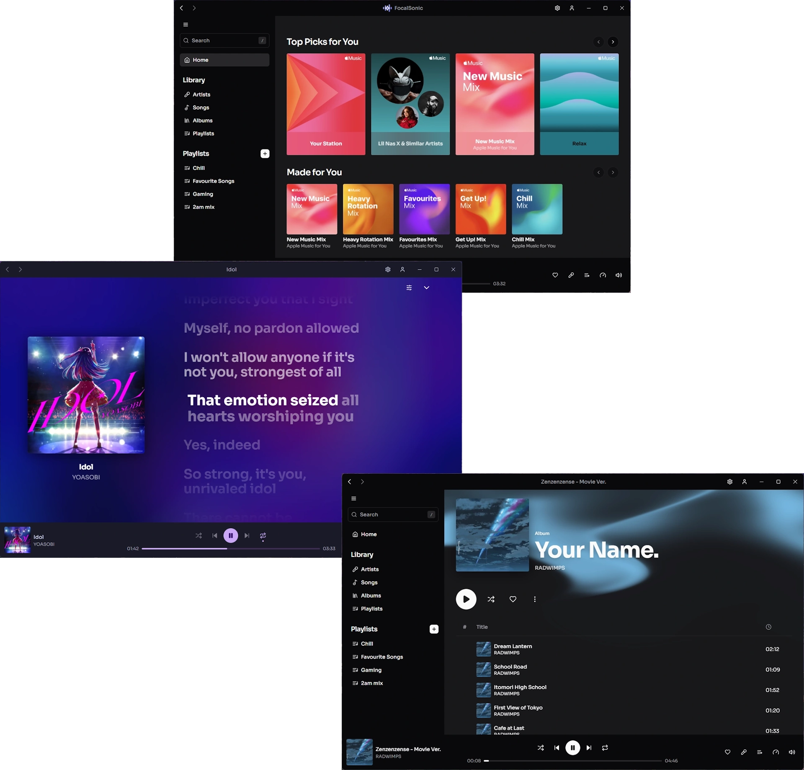

# FocalSonic 

Free and open source Apple Music client for Windows 11 and macOS

# Features

- **Customization** - Easily customize the colors and fonts of the UI
- **Background Audio Playback** - Save resources by closing the player window
- **Speed Control** - Slow down or speed up your music with smooth time stretching
- **Lyrics** - Support for syllable-synced lyrics, including pronunciations for foreign languages
- **Discord RPC** - Show off what you're listening to on your Discord profile
- **Apple Music Radio** - Radio playback from personal radio stations 
- **Dolby Atmos** - (EXPERIMENTAL) Dolby Atmos on a select number of tracks from Apple's library

## Future Plans

 - Linux support

## Not Planned / Won't Implement

 - ❌ Lossless audio 
 Reason: Apple doesn't provide any legal method of playing DRM protected lossless files on Windows.

 - ❌ AutoMix / Sing / Apple Intelligence features  
 Reason: Windows PCs don't support Apple Intelligence

Please do not open issues regarding these features.

## Contributing
Pull requests are accepted, we would be glad to incorporate your contributions.

Ensure to install the following dependencies:
- .NET 9
- NodeJS / NPM

After that, running from source is simple:  
1. `git clone https://github.com/SamsidParty/FocalSonic.git`
2. `cd ./FocalSonic/FocalSonic/src-vite`
3. `npm install --force`
4. `cd ..`
5. `dotnet run`

### macOS

On macOS, Apple Music plays through native MusicKit instead of a web player window, via a small Swift helper ([FocalSonic.MacHelper](FocalSonic.MacHelper/README.md)) that the build compiles automatically. You'll additionally need:
- .NET 10 SDK
- Xcode or the Xcode Command Line Tools (for `swiftc`)
- macOS 14.4 or later, signed into an Apple Account with an Apple Music subscription

`dotnet run` works the same way. To build a standalone `FocalSonic.app`, run `FocalSonic/MacApp/build-app.sh` (output in `FocalSonic/bin/production/osx-<arch>/`). Set `CODESIGN_IDENTITY` to a Developer ID identity to sign it with the hardened runtime for distribution.

When run from a terminal, macOS asks the terminal app for Apple Music and audio recording access; the `.app` asks on its own behalf.
